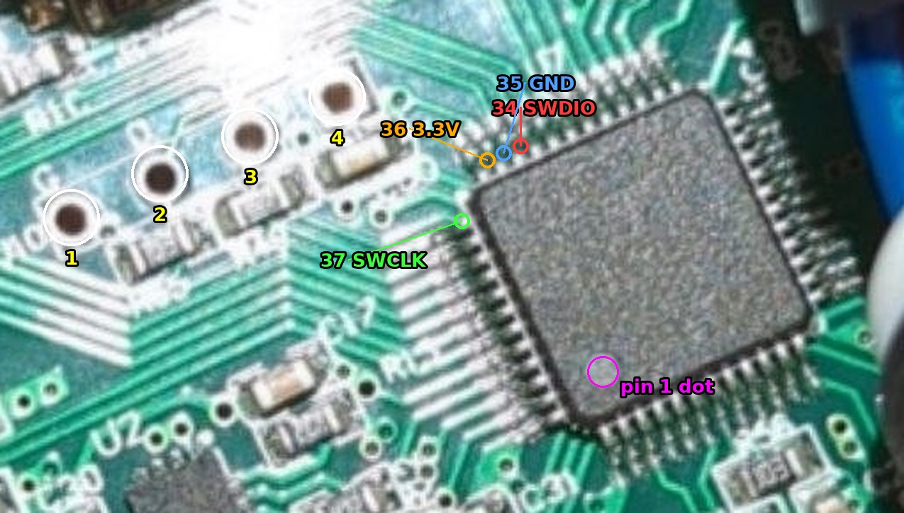

# 11. Hoverboard drive

How a stock hoverboard becomes the drive of a robot: identify the mainboard, reflash it with open firmware
over SWD, test the motors, then let the RP2040 drive it over UART. Hoverboards differ a lot, so this document
is split into a common procedure and one section per board model. **Every new board model gets its own
section** (template at the end), so the next robot of the same model takes minutes.

Status marks: ✅ done on our hardware, ⏳ planned / not yet tested by us.

## Requirements

- `HOV-001` The mainboard runs open firmware that stops the motors on its own when commands stop (Gen2.x
  `REMOTE_UARTBUS`: soft stop after 0.5 s, PWM off after 2 s). This is the last line of defence behind the
  RP2040 failsafes ([05](05-safety.md)), never a replacement for them.
- `HOV-002` The hoverboard's own firmware is never trusted for robot use: stock firmware has no command input
  and balances on its gyro. Every board is reflashed.
- `HOV-003` Every board model we use is documented below: identification, layout, SWD pads, firmware build
  options, test results. Firmware sources and versions are pinned per model.
- `HOV-004` First power-up of a reflashed board: wheels off the ground, current-limited supply (1–2 A) or a
  2–3 A fuse in series with the battery, test firmware (`REMOTE_DUMMY`) before any remote control.

## Board families

| Family | How to recognize | Chip | Open firmware |
|--------|------------------|------|---------------|
| Gen1 | one mainboard in the middle, two small gyro boards on the sides, STM32/GD32**F103RCT6** (64 pins) | STM32F103RC / GD32F103RC | EFeru `hoverboard-firmware-hack-FOC` (⏳ not used by us yet) |
| Gen2.x | **two** identical-looking boards, one per wheel (master + slave), gyro on the board, 48-pin chip | GD32F130C8, GD32F103C8, GD32E230C8, MM32SPIN05 | RoboDurden `Hoverboard-Firmware-Hack-Gen2.x-GD32` |

Gen2.x has many PCB layouts (`Inc/defines/defines_2-<target>-<layout>.h`, photos in the docs repo
`RoboDurden/Hoverboard-Firmware-Hack-Gen2.x`, folder `Overview/`). A wrong layout can switch both MOSFETs of a
half-bridge on and short the battery, so match the layout by photo and silkscreen, not by guess.

## Tools

| What | Where | Notes |
|------|-------|-------|
| SWD probe | any RP2040 board with `debugprobe_on_pico.uf2` (`raspberrypi/debugprobe`, tested v2.3.1) | an ST-Link works too (`interface/stlink.cfg`) |
| `openocd` | Debian package `openocd` (tested 0.12.0) | |
| `tools/hoverboard_swd.sh` | this repo | `info`, `backup`, `unlock --erase`, `flash`, `rtt` |
| Gen2.x firmware | `git clone https://github.com/RoboDurden/Hoverboard-Firmware-Hack-Gen2.x-GD32` (tested `c63b29a`) | builds with the system `gcc-arm-none-eabi` + `make` |
| GD32 SPL (needed by the Gen2.x Makefile) | `git clone -b hoverboardhavoc/add__PIO_DONT_SET_CLOCK_SOURCE__ https://github.com/hoverboardhavoc/gd32-pio-spl-package.git HoverBoardGigaDevice/lib/framework` (tested `8849cb2`) | the same package `platformio.ini` uses; the Makefile patches its clock setup to the internal oscillator |
| Multimeter with continuity beep, fine probe tip | | finding SWD pads |
| Lab supply 36–42 V with current limit, or a 2–3 A fuse | | first motor test (`HOV-004`) |

Third-party code is kept outside the repo (e.g. `~/Downloads/hoverboard/`): it is only built and flashed onto
the hoverboard, nothing of it ends up in AeroLink.

## Common procedure

1. **Identify.** Open the hoverboard, photograph both sides of every board. Note the chip marking, the PCB name
   on the silkscreen (e.g. `TT-SD2.2`), connectors. Find the family and layout (table above, Gen2.x `Overview/`
   photos). If the model already has a section below, follow it and skip the search.
2. **Find SWD.** Four pads or pins near the chip, often labelled `G D C V` / `GND DIO CLK 3V3`, sometimes not
   labelled at all. Confirm with continuity to the chip pins (power off): for the 48-pin parts (LQFP48) **SWDIO
   = PA13 = pin 34**, **SWCLK = PA14 = pin 37**, GND = pin 35 (or 23, 47), 3.3 V = pin 36 (or 24, 48). Pin 1 is
   at the dot on the package, pins run counter-clockwise, 12 per side; pins 34–36 end the third side and 37
   starts the fourth, so all four sit around one corner: the far end of the side that ends with pin 48 at the dot. For the 64-pin F103RC (Gen1): SWDIO = pin 46, SWCLK = pin 49.
3. **Wire the probe** (debugprobe pin-out; on clones check the silkscreen, not pin numbers):

   | RP2040 | Board |
   |--------|-------|
   | GP2 | SWCLK |
   | GP3 | SWDIO |
   | GND | GND |
   | 3V3 OUT | 3.3 V — **only while the battery is disconnected** |

   For reading, unlocking and flashing the board runs from the probe's 3.3 V with the battery **off**: the power
   stage stays dead, nothing can spin or burn. Before powering the board from its battery, disconnect the 3V3
   wire (the board's own regulator must not fight the probe); GND, SWDIO, SWCLK may stay for the RTT log.
4. **Probe the RP2040.** Hold BOOTSEL, plug it in, `picotool load -x debugprobe_on_pico.uf2`. `lsusb` shows
   `2e8a:000c Debugprobe on Pico (CMSIS-DAP)`. When done with the hoverboard, `make flash` puts the AeroLink
   firmware back.
5. **Read the chip** (changes nothing): `tools/hoverboard_swd.sh info` → device ID, flash/RAM size, read
   protection. If protection is off, `tools/hoverboard_swd.sh backup stock.bin` saves the stock firmware.
   Stock boards usually have protection on: there is no way to save the stock firmware then.
6. **Unlock** (irreversible, erases the stock firmware): `tools/hoverboard_swd.sh unlock --erase`. `info` must
   now show `read protection: off` and the flash reads `0xffffffff`.
7. **Build the test firmware** (`REMOTE_DUMMY`, settings per model below):
   `make -C ~/Downloads/hoverboard/gen2x/HoverBoardGigaDevice` → `build/GD32F130.bin` (name follows the chip).
8. **Flash**: `tools/hoverboard_swd.sh flash .../build/GD32F130.bin` (writes, verifies, starts it).
9. **Check it runs** on the probe's 3.3 V: `tools/hoverboard_swd.sh rtt` prints a line per ~100 ms:
   `2.3 V  0.20 A  odom: 0  target: -200 …`. `target` swinging ±200 = the dummy remote runs; the voltage is
   meaningless without the battery.
10. **Motor test** (`HOV-004`): disconnect the probe's 3V3 wire, wheel up, motor phases + hall connected,
    current-limited supply or fused battery on the battery connector, press the power button. The wheel swings
    back and forth slowly (period `REMOTE_PERIOD`), the LEDs follow the hall sensors. Jerking, humming, or the
    supply hitting its current limit → power off at once: phase or hall order is wrong, or the layout is.
11. **Robot firmware** (⏳): rebuild with the remote protocol the RP2040 speaks (see "Driving it from the
    RP2040"), flash, repeat the motor test, then connect the RP2040.
12. **Record** the result in the model's section (date, firmware commit, what worked).

## Driving it from the RP2040 (⏳ not built yet)

Planned for Gen2.x: both boards run `SINGLE` firmware with `REMOTE_UARTBUS` and different `SLAVE_ID`s (0 =
left, 1 = right); the RP2040 is the bus master on one UART (19200 baud, RP2040 TX → both boards' RX, both
boards' TX → RP2040 RX; how two TX outputs share one line is still to be checked in the Gen2.x sources). Every board stops on its own when its
commands stop (`HOV-001`) and answers only when addressed, with speed, voltage, current and odometer — which
maps onto TELEMETRY ([03](03-usb-link.md)). Alternative: `MASTER` + `SLAVE` firmware over the original
master–slave cable, the RP2040 talks `REMOTE_UART` to the master only. The choice is open question Q1
([07](07-open-questions.md)); the RP2040 side becomes `rp2040/src/motor_hoverboard.c`
(`AEROLINK_MOTOR_DRIVER=hoverboard`).

Known issue to check first: Gen2.x issue #153 reports on the same `TT-SD2.2` board that `REMOTE_UART`
telemetry works but speed commands do not move the motor, while `REMOTE_DUMMY` does. Test the UART remote with
a USB-UART adapter before writing the driver.

## Models

### Gen2.1.1 — `TT-SD2.2`, GD32F130C8T6 ✅ (first robot, 2026-10-30)



- **Recognize:** two boards, silkscreen `TT-SD2.2` and `692207`, chip `GD32F130C8T6` (U7), wireless module
  "Grape", connectors HALL (5-pin), X1–X3, VBAT (red), CHARGER/Switch/To Slave on the master. Matches Gen2.x
  layout **2.1.1** (formerly "2.0"), the reference photo `Overview/Gen2.1.1.jpg`. Master board: buzzer, charger
  port, power button, battery voltage measurement; slave: battery connector, linked by the 4-wire cable.
- **SWD:** row of four through-hole pads left of the chip (photo, white circles numbered from the edge of the
  board towards the chip): **1 = GND** (silkscreen `G`), **2 = SWDIO** (pin 34), **3 = SWCLK** (pin 37),
  **4 = 3.3 V** (pin 36). Verified by continuity.
- **Remote UART:** pads `REMOTE  T R 5V` (+ `G`) next to the SWD row = USART0 PB6/PB7 (Gen2.x `REMOTE_USART 0`,
  "the empty header close to the flash header"). Logic is 3.3 V; never connect the `5V` pad to the RP2040.
- **Chip as delivered:** device ID `0x13030410` (GD32, rev `0x1303`), 64 KB flash, 8 KB RAM, read protection
  **on** (option byte `0x5A`) → stock firmware not saved, unlocked with mass erase.
- **openocd:** `target/stm32f1x.cfg` with `CPUTAPID 0` (DPIDR `0x1ba01477`, Cortex-M3) — the default of
  `tools/hoverboard_swd.sh`. Unlock took effect after `reset halt`, no power cycle needed.
- **Firmware:** Gen2.x `c63b29a`, `Inc/config.h` as shipped: `LAYOUT 1`, `LAYOUT_SUB 1`, `SINGLE`,
  `REMOTE_DUMMY` (`REMOTE_PERIOD 6`, `TEST_HALL2LED`, `RTT_REMOTE`), `BLDC_SINE`, `DRIVING_MODE 0` (PWM),
  `BAT_CELLS 10`, `DC_CUR_LIMIT 15`. Image 26 368 bytes.
- **Results:** first board flashed, RTT log OK on 3.3 V, the wheel swings under power (2026-10-30). Second
  board ⏳, UART remote ⏳.

### Template for a new model

```
### <family + layout> — `<silkscreen>`, <chip> <status> (<robot>, <date>)
- Recognize: silkscreen, chip, connectors, reference photo / layout file.
- SWD: where the pads are, which is which (photo in docs/hoverboard/), how verified.
- Remote UART: pads/header, pins, voltage.
- Chip as delivered: device ID, flash/RAM, read protection, backup file (if any).
- openocd: target script and quirks.
- Firmware: repo + commit, every changed option.
- Results: what was tested, what is open.
```

## Troubleshooting

| Symptom | Cause / fix |
|---------|-------------|
| `Error connecting DP: cannot read IDR` | board has no 3.3 V, SWDIO/SWCLK swapped, or a bad solder joint |
| `Failed to read memory at 0x08000000` | read protection is on (`info` shows it); only `unlock --erase` helps |
| `UNEXPECTED idcode` / wrong target | GD32 reports another TAP ID: keep `set CPUTAPID 0`; GD32E230 (Cortex-M23) and MM32SPIN05 need another target script (⏳ untested) |
| Gen2.x build: `gd32f1x0.h: No such file or directory` | the GD32 SPL is missing in `HoverBoardGigaDevice/lib/framework` (Tools) |
| `_read`/`_write is not implemented` warnings at link time | harmless (newlib stubs) |
| `rtt`: no control block found | the firmware is built without `RTT_REMOTE`, or it is not running (check `info`) |
| Testing with the hoverboard charger as the power supply | build with `DISABLE_CHARGESTATE` (`config.h`), otherwise the firmware treats it as charging |
