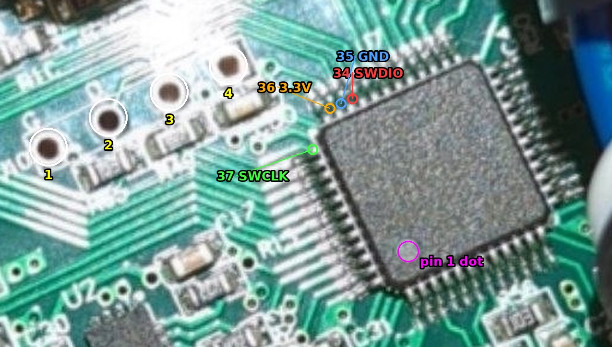

# 11. Hoverboard drive

How a stock hoverboard becomes the drive of a robot: identify the mainboard, reflash it with open firmware
over SWD, test the motors, then let the RP2040 drive it over UART. Hoverboards differ a lot, so this document
is split into a common procedure and one section per board model. **Every new board model gets its own
section** (template at the end), so the next robot of the same model takes minutes.

Status marks: ✅ done on our hardware, ⏳ planned / not yet tested by us.

## Requirements

- `HOV-001` The mainboard runs open firmware that stops the motors on its own when commands stop (Gen2.x
  `REMOTE_UARTBUS`: soft stop after 0.5 s, PWM off after 2 s). This is the last line of defence behind the
  RP2040 failsafes ([05](05-safety.md)), never a replacement for them.
- `HOV-002` The hoverboard's own firmware is never trusted for robot use: stock firmware has no command input
  and balances on its gyro. Every board is reflashed.
- `HOV-003` Every board model we use is documented below: identification, layout, SWD pads, firmware build
  options, test results. Firmware sources and versions are pinned per model.
- `HOV-004` First power-up of a reflashed board: wheels off the ground, current-limited supply (1–2 A) or a
  2–3 A fuse in series with the battery, test firmware (`REMOTE_DUMMY`) before any remote control.

## Board families

| Family | How to recognize | Chip | Open firmware |
|--------|------------------|------|---------------|
| Gen1 | one mainboard in the middle, two small gyro boards on the sides, STM32/GD32**F103RCT6** (64 pins) | STM32F103RC / GD32F103RC | EFeru `hoverboard-firmware-hack-FOC` (⏳ not used by us yet) |
| Gen2.x | **two** identical-looking boards, one per wheel (master + slave), gyro on the board, 48-pin chip | GD32F130C8, GD32F103C8, GD32E230C8, MM32SPIN05 | RoboDurden `Hoverboard-Firmware-Hack-Gen2.x-GD32` |

Gen2.x has many PCB layouts (`Inc/defines/defines_2-<target>-<layout>.h`, photos in the docs repo
`RoboDurden/Hoverboard-Firmware-Hack-Gen2.x`, folder `Overview/`). A wrong layout can switch both MOSFETs of a
half-bridge on and short the battery, so match the layout by photo and silkscreen, not by guess.

## Tools

| What | Where | Notes |
|------|-------|-------|
| SWD probe | any RP2040 board with `debugprobe_on_pico.uf2` (`raspberrypi/debugprobe`, tested v2.3.1) | an ST-Link works too (`interface/stlink.cfg`) |
| `openocd` | Debian package `openocd` (tested 0.12.0) | |
| `tools/hoverboard_swd.sh` | this repo | `info`, `backup`, `unlock --erase`, `flash`, `rtt` |
| `tools/hoverboard_build.sh MODEL` | this repo | clones the pinned sources (`hoverboard/<model>/build.conf`) into `build/hoverboard/`, applies the model's `config.h`, builds `firmware-id<N>.bin` per `SLAVE_ID` + `SHA256SUMS` into `hoverboard/<model>/` |
| `tools/hoverboard_uart.py` | this repo | `REMOTE_UARTBUS` bench test from the PC: commands at 20 Hz, prints replies; needs `python3-serial` |
| Gen2.x firmware | `git clone https://github.com/RoboDurden/Hoverboard-Firmware-Hack-Gen2.x-GD32` (tested `c63b29a`) | builds with the system `gcc-arm-none-eabi` + `make` |
| GD32 SPL (needed by the Gen2.x Makefile) | `git clone -b hoverboardhavoc/add__PIO_DONT_SET_CLOCK_SOURCE__ https://github.com/hoverboardhavoc/gd32-pio-spl-package.git HoverBoardGigaDevice/lib/framework` (tested `8849cb2`) | the same package `platformio.ini` uses; the Makefile patches its clock setup to the internal oscillator |
| Multimeter with continuity beep, fine probe tip | | finding SWD pads |
| Lab supply 36–42 V with current limit, or a 2–3 A fuse | | first motor test (`HOV-004`) |

Third-party sources stay outside the repo (`build/hoverboard/`, cloned by `hoverboard_build.sh`); the repo keeps
per model only what we change and what we flash: `hoverboard/<model>/config.h`, `build.conf`, the images and
the GPL-3.0 license text ([hoverboard/README.md](../hoverboard/README.md)). **A known model needs no build:**
flash the committed images (steps 5, 6, 11, 12 and the model section).

## Common procedure

1. **Identify.** Open the hoverboard, photograph both sides of every board. Note the chip marking, the PCB name
   on the silkscreen (e.g. `TT-SD2.2`), connectors. Find the family and layout (table above, Gen2.x `Overview/`
   photos). If the model already has a section below, follow it and skip the search.
2. **Find SWD.** Four pads or pins near the chip, often labelled `G D C V` / `GND DIO CLK 3V3`, sometimes not
   labelled at all. Confirm with continuity to the chip pins (power off): for the 48-pin parts (LQFP48) **SWDIO
   = PA13 = pin 34**, **SWCLK = PA14 = pin 37**, GND = pin 35 (or 23, 47), 3.3 V = pin 36 (or 24, 48). Pin 1 is
   at the dot on the package, pins run counter-clockwise, 12 per side; pins 34–36 end the third side and 37
   starts the fourth, so all four sit around one corner: the far end of the side that ends with pin 48 at the dot. For the 64-pin F103RC (Gen1): SWDIO = pin 46, SWCLK = pin 49.
3. **Wire the probe** (debugprobe pin-out; on clones check the silkscreen, not pin numbers):

   | RP2040 | Board |
   |--------|-------|
   | GP2 | SWCLK |
   | GP3 | SWDIO |
   | GND | GND |
   | 3V3 OUT | 3.3 V — **only while the battery is disconnected** |

   For reading, unlocking and flashing the board runs from the probe's 3.3 V with the battery **off**: the power
   stage stays dead, nothing can spin or burn. Before powering the board from its battery, disconnect the 3V3
   wire (the board's own regulator must not fight the probe); GND, SWDIO, SWCLK may stay for the RTT log.
4. **Probe the RP2040.** Hold BOOTSEL, plug it in, `picotool load -x debugprobe_on_pico.uf2`. `lsusb` shows
   `2e8a:000c Debugprobe on Pico (CMSIS-DAP)`. When done with the hoverboard, `make flash` puts the AeroLink
   firmware back.
5. **Read the chip** (changes nothing): `tools/hoverboard_swd.sh info` → device ID, flash/RAM size, read
   protection. If protection is off, `tools/hoverboard_swd.sh backup stock.bin` saves the stock firmware.
   Stock boards usually have protection on: there is no way to save the stock firmware then.
6. **Unlock** (irreversible, erases the stock firmware): `tools/hoverboard_swd.sh unlock --erase`. `info` must
   now show `read protection: off` and the flash reads `0xffffffff`.
7. **Build the test firmware** (`REMOTE_DUMMY`, settings per model below):
   `make -C ~/Downloads/hoverboard/gen2x/HoverBoardGigaDevice` → `build/GD32F130.bin` (name follows the chip).
8. **Flash**: `tools/hoverboard_swd.sh flash .../build/GD32F130.bin` (writes, verifies, starts it).
9. **Check it runs** on the probe's 3.3 V: `tools/hoverboard_swd.sh rtt` prints a line per ~100 ms:
   `2.3 V  0.20 A  odom: 0  target: -200 …`. `target` swinging ±200 = the dummy remote runs; the voltage is
   meaningless without the battery.
10. **Motor test** (`HOV-004`): disconnect the probe's 3V3 wire, wheel up, motor phases + hall connected,
    current-limited supply or fused battery on the battery connector, press the power button. The wheel swings
    back and forth slowly (period `REMOTE_PERIOD`), the LEDs follow the hall sensors. Jerking, humming, or the
    supply hitting its current limit → power off at once: phase or hall order is wrong, or the layout is.
11. **UART firmware**: `hoverboard/<model>/firmware-id0.bin` (left) / `firmware-id1.bin` (right), flashed the
    same way (battery off, probe 3V3 on). New model: copy a similar model's directory, put its `config.h` from
    upstream there with `REMOTE_UARTBUS` on, `REMOTE_DUMMY` and `INACTIVITY_TIMEOUT` off, then
    `tools/hoverboard_build.sh <model>`. Wire the UART pads to
    the probe's own UART (debugprobe: GP4 = TX → board RX, GP5 = RX ← board TX, shows up as `/dev/ttyACM0`; any
    3.3 V USB-UART works too, never 5 V). Still on the probe's 3.3 V, `tools/hoverboard_uart.py` must get a reply
    for every command (`sent 20, replies 20`); none → wiring (bridge GP4–GP5 and the bytes must come back).
12. **UART motor test**: probe 3V3 off, wheel up, battery on, power button. `hoverboard_uart.py` (speed 0) shows
    the battery voltage, then `hoverboard_uart.py --speed 100 --time 3`: the wheel turns slowly, the odometer
    counts, and the wheel stops by itself ~0.5 s after the last command (`HOV-001`; the board stays silent then,
    watch the odometer `iOdom` over SWD if in doubt).
13. **Record** the result in the model's section (date, firmware commit, what worked).

## Driving it from the RP2040 (⏳ driver built and host-tested, not yet run on the boards)

Gen2.x (Q1, resolved): both boards run `SINGLE` firmware with `REMOTE_UARTBUS`, each on **its own RP2040
UART** — no shared bus, no master–slave cable. The driver is `rp2040/src/motor_hoverboard.c` (UART glue) +
`hoverbus.c` (protocol, host-tested in `rp2040/test/test_hover.c`), selected by `MOTOR_DRIVER=hoverboard`, the
default of `make rp2040`; `MOTOR_DRIVER=sim` builds the simulator for bench tests on a bare board.

| Board | `SLAVE_ID` | RP2040 | Board pad |
|-------|-----------|--------|-----------|
| left  | 0 | UART0: GP0 = TX, GP1 = RX | GP0 → `R`, GP1 ← `T` |
| right | 1 | UART1: GP4 = TX, GP5 = RX | GP4 → `R`, GP5 ← `T` |

Plus one GND per board (`G` pad). Never connect the `5V` pad. GP4/GP5 are the same pins the debugprobe's UART
uses, so a board wired for the bench test (step 12) stays wired the same way.

- Every 20 ms each board gets the latest control output (‰ = the firmware's PWM −1000..1000, the right side
  inverted because its motor is mounted mirrored; ⏳ check the directions on the robot) with wState 32 (battery
  level on the board's LEDs). When the RP2040 stops sending, the boards stop on their own (`HOV-001`).
- A board with no valid reply for 300 ms (2 s grace after power-up) → `FAULT_MOTOR_LINK_LOST` → `FAULT`
  (`SAFE-006`); a reply with the other board's id does not count, so swapped cables show up as link lost.
  TELEMETRY: battery = mean of both boards, wheel speed in ‰ of 15 km/h (rough, ⏳ calibrate), below 32 V
  `FAULT_LOW_BATTERY` (not critical).
- The debug log needs a UART that is now taken, so this build logs over **RTT** instead of GP0: a second RP2040
  as debugprobe on the robot's SWD pins, then `OPENOCD_TARGET=target/rp2040.cfg RTT_RAM="0x20000000 0x42000"
  tools/hoverboard_swd.sh rtt`. Look for `hoverboard left/right link up/lost`.

`REMOTE_UARTBUS` frames (Gen2.x `Src/remoteUartBus.c`, reference encoder in `tools/hoverboard_uart.py`), all
little-endian, CRC = CRC-16/XMODEM (poly 0x1021, init 0) over everything before it:

| Frame | Layout | Bytes |
|-------|--------|-------|
| command (type 0) | `'/'`, `0`, slave id, int16 speed, uint8 wState, uint16 crc | 8 |
| reply | uint16 `0xABCD`, slave id, int16 speed (100 × km/h), uint16 volt (100 × V), int16 amp (100 × A), int32 odometer (hall steps), uint16 crc | 15 |

A board answers only a valid command with its own id, right after it; with no commands it stays silent. wState
bits: 1/2/4 LEDs green/orange/red, 8/16 up/down, 32 battery LEDs, 64 disable motor, 128 shut off. After a CRC
error the board needs two further `'/'` starts to resync. Gen2.x issue #153 (`REMOTE_UART` not driving on the
same board) does not affect `REMOTE_UARTBUS`: tested OK, see the model section.

## Models

### Gen2.1.1 — `TT-SD2.2`, GD32F130C8T6 ✅ (first robot, 2026-10-30)



- **Recognize:** two boards, silkscreen `TT-SD2.2` and `692207`, chip `GD32F130C8T6` (U7), wireless module
  "Grape", connectors HALL (5-pin), X1–X3, VBAT (red), CHARGER/Switch/To Slave on the master. Matches Gen2.x
  layout **2.1.1** (formerly "2.0"), the reference photo `Overview/Gen2.1.1.jpg`. Master board: buzzer, charger
  port, power button, battery voltage measurement; slave: battery connector, linked by the 4-wire cable.
- **SWD:** row of four through-hole pads left of the chip (photo, white circles numbered from the edge of the
  board towards the chip): **1 = GND** (silkscreen `G`), **2 = SWDIO** (pin 34), **3 = SWCLK** (pin 37),
  **4 = 3.3 V** (pin 36). Verified by continuity.
- **Remote UART:** pads `REMOTE  T R 5V` (+ `G`) next to the SWD row = USART0 PB6/PB7 (Gen2.x `REMOTE_USART 0`,
  "the empty header close to the flash header"). Logic is 3.3 V; never connect the `5V` pad to the RP2040.
  Verified: `T` = board TX (PB6) → probe GP5, `R` = board RX (PB7) ← probe GP4, GND via the SWD `G` pad.
- **Chip as delivered:** device ID `0x13030410` (GD32, rev `0x1303`), 64 KB flash, 8 KB RAM, read protection
  **on** (option byte `0x5A`) → stock firmware not saved, unlocked with mass erase.
- **openocd:** `target/stm32f1x.cfg` with `CPUTAPID 0` (DPIDR `0x1ba01477`, Cortex-M3) — the default of
  `tools/hoverboard_swd.sh`. Unlock took effect after `reset halt`, no power cycle needed.
- **Firmware:** [`hoverboard/gen2x-tt-sd2.2/`](../hoverboard/gen2x-tt-sd2.2/) — `firmware-id0.bin` (left),
  `firmware-id1.bin` (right), 20 296 bytes each. Gen2.x `c63b29a`, our `config.h` = upstream with `REMOTE_UARTBUS`,
  `SLAVE_ID`, `RTT_REMOTE` on and `REMOTE_DUMMY`, `INACTIVITY_TIMEOUT` off. Upstream `Inc/config.h` as shipped: `LAYOUT 1`, `LAYOUT_SUB 1`, `SINGLE`,
  `REMOTE_DUMMY` (`REMOTE_PERIOD 6`, `TEST_HALL2LED`, `RTT_REMOTE`), `BLDC_SINE`, `DRIVING_MODE 0` (PWM),
  `BAT_CELLS 10`, `DC_CUR_LIMIT 15`, `INACTIVITY_TIMEOUT 8` (`SINGLE` = `MASTER_OR_SINGLE`: the board **switches
  itself off after 8 min without driving**, only the power button brings it back; off in our images). Image 26 368 bytes. UART variant: `REMOTE_UARTBUS`, `SLAVE_ID 0`, no
  `REMOTE_DUMMY` (its RTT status log goes with it), 20 332 bytes; one build per board, only `SLAVE_ID` differs
  (0 and 1).
- **Results** (first board):
  - 2026-10-30: dummy firmware, RTT log OK on 3.3 V, the wheel swings under power.
  - 2026-10-31: `REMOTE_UARTBUS` from the PC through the debugprobe UART: 60/60 replies, speed 100 → 0.6 km/h,
    76 hall steps in 3 s, the wheel stops by itself 0.5–0.8 s after the last command. Positive speed counts the
    odometer **down** on this wheel (the driver maps direction per side). Voltage reads 28 V on the battery as
    found (⏳ compare with a multimeter: either the battery is nearly empty or the divider needs calibration).
  - 2026-10-31, second board: read protection on as well, unlocked, `SLAVE_ID 1` flashed; on the probe's 3.3 V
    it answers id 1 (20/20) and ignores id 0. On the battery: speed 100 → 0.58 km/h, 68 hall steps in 3 s, odometer
    again counts down, stops by itself after the last command. Reads 28.4–29.6 V like the first board.

### Template for a new model

```
### <family + layout> — `<silkscreen>`, <chip> <status> (<robot>, <date>)
- Recognize: silkscreen, chip, connectors, reference photo / layout file.
- SWD: where the pads are, which is which (photo in docs/hoverboard/), how verified.
- Remote UART: pads/header, pins, voltage.
- Chip as delivered: device ID, flash/RAM, read protection, backup file (if any).
- openocd: target script and quirks.
- Firmware: repo + commit, every changed option.
- Results: what was tested, what is open.
```

## Troubleshooting

| Symptom | Cause / fix |
|---------|-------------|
| `Error connecting DP: cannot read IDR` | board has no 3.3 V, SWDIO/SWCLK swapped, or a bad solder joint |
| `Failed to read memory at 0x08000000` | read protection is on (`info` shows it); only `unlock --erase` helps |
| `UNEXPECTED idcode` / wrong target | GD32 reports another TAP ID: keep `set CPUTAPID 0`; GD32E230 (Cortex-M23) and MM32SPIN05 need another target script (⏳ untested) |
| Gen2.x build: `gd32f1x0.h: No such file or directory` | the GD32 SPL is missing in `HoverBoardGigaDevice/lib/framework` (Tools) |
| `_read`/`_write is not implemented` warnings at link time | harmless (newlib stubs) |
| `rtt`: no control block found | the firmware is built without `RTT_REMOTE`, or it is not running (check `info`) |
| Board dead after a few idle minutes, needs the power button | `INACTIVITY_TIMEOUT` (8 min) in Gen2.x `config.h`; comment it out for robots |
| Testing with the hoverboard charger as the power supply | build with `DISABLE_CHARGESTATE` (`config.h`), otherwise the firmware treats it as charging |
